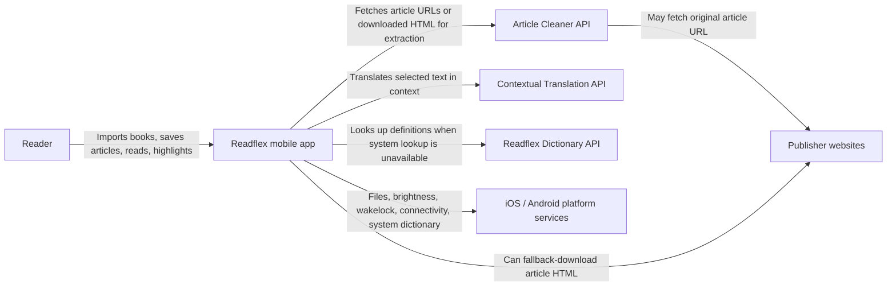
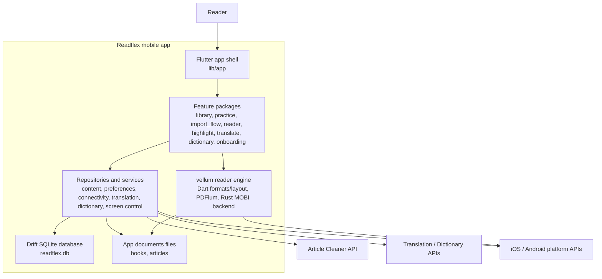
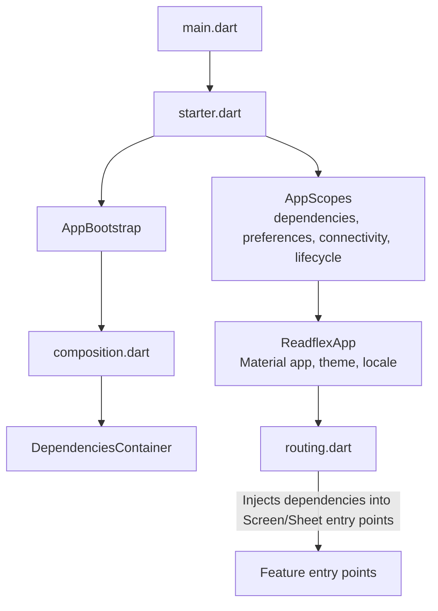
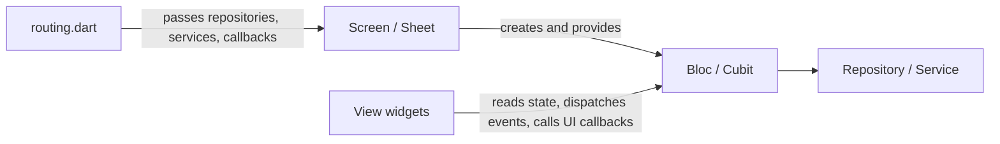
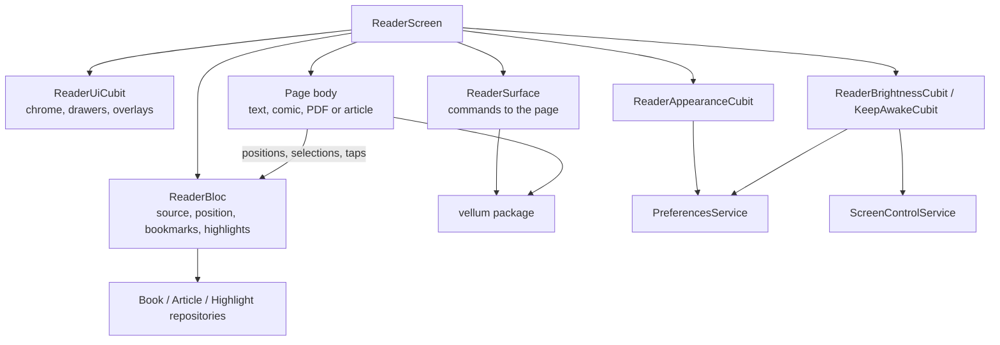
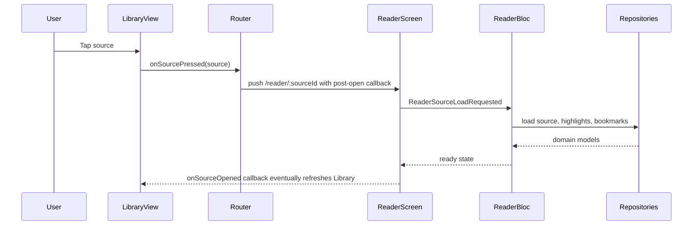
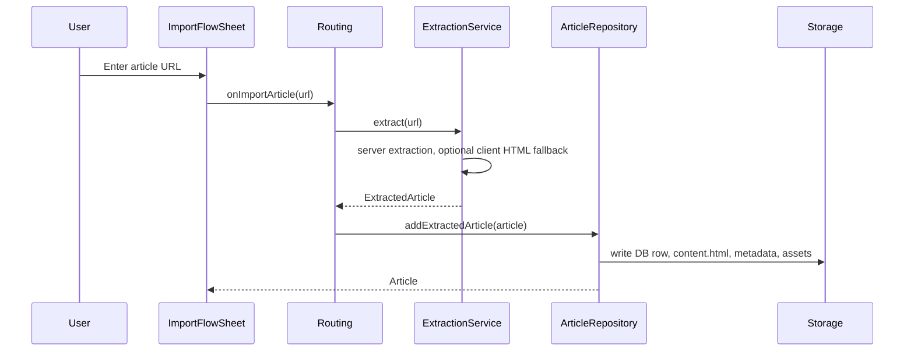
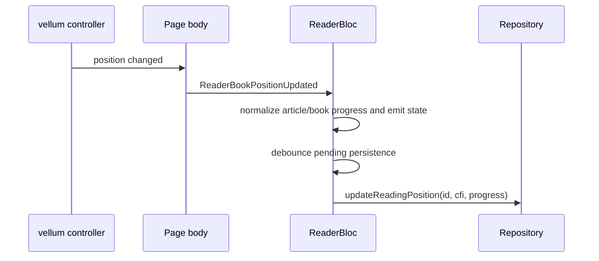

# Readflex C4 Model

This document describes the current Readflex architecture using the C4 model.
It complements `ARCHITECTURE.md`: that file defines package rules and
maintainer conventions, while this file shows the system from progressively
lower levels of abstraction.

The implementation is the source of truth. Update this model when package
boundaries, runtime containers, storage ownership, or integration points change.

## Level 1: System Context

Readflex is a mobile reading app for imported books, saved web articles, and
highlights. It runs on iOS and Android, stores user data locally, draws books
and articles with its own reader engine (`vellum`), and optionally calls
remote article cleaning, contextual translation, and dictionary backends.

### External Systems

| System | Responsibility | Current integration |
|--------|----------------|---------------------|
| Article Cleaner API | Extracts readable article content from URLs or downloaded HTML. | `article_extraction_service` via HTTP. |
| Publisher websites | Original article pages and assets. | Article cleaner server fetches first; app can fallback-download HTML. |
| Contextual Translation API | Resolves selected text using surrounding reading context. | `contextual_translation_service` via HTTP. |
| Readflex Dictionary API | Returns validated, cached monolingual lexical definitions. | `dictionary_service` via HTTP after native lookup fallback. |
| iOS / Android platform services | Files, image codecs, brightness, wakelock, connectivity, native dictionary UI. | Flutter plugins, app runner channels, and local packages. |

The backend implementations are outside this checkout. Their provider calls,
server-side caches and deployment details are not client-owned contracts.
PDFium and the Rust MOBI library are bundled reader dependencies, not system
PDF or dictionary services.

## Level 2: Containers

Readflex is shipped as one Flutter mobile app, but internally it has clear
runtime containers: the Flutter UI/runtime with its reader engine, a local
Drift database, and app-owned files.

### Container Responsibilities

| Container | Code location | Responsibility |
|-----------|---------------|----------------|
| Flutter app shell | `lib/app` | Bootstrap, dependency composition, scopes, GoRouter routes, app lifecycle, system UI mode. |
| Feature packages | `packages/features/*` | User-facing flows and feature state management. |
| Repositories/services | `packages/*_repository`, `packages/*_service`, specialized packages | Data source orchestration, platform/backend contracts, persistence boundaries. |
| Local database | `packages/local_storage` | Drift schema, DAOs, migrations, storage rows. |
| App files | App documents directory | Imported books, extracted article HTML and assets. |
| Reader engine | `packages/vellum` | Opens EPUB, FB2, MOBI/KF8, CBZ, PDF and saved articles from their files, lays them out and draws their pages; import metadata, search, selection, CFIs. |
| MOBI text backend | `packages/vellum_mobi_native` | Vellum's Rust record I/O and PalmDOC/HUFF-CDIC decoder over FRB; lazy KF8 reads and batched MOBI 6 text, built through Native Assets. Headers, chapters, document parsing and UI remain in Dart. |

## Level 3: Components

### App Shell Components

| Component | Responsibility |
|-----------|----------------|
| `starter.dart` | Flutter binding, error zone, logging, bloc observer, tracing, app mounting and recovery screen. |
| `app_bootstrap.dart` | Configuration validation, monitoring initialization/reuse, dependency creation and failed-attempt cleanup. |
| `composition.dart` | Creates database, repositories, services and document directories. |
| `dependency_container.dart` / `resource_disposer.dart` | Explicit dependency holder and reverse-order, idempotent cleanup; rollback retains monitoring for retry. |
| `app_scopes.dart` / `readflex_app.dart` / `app_lifecycle.dart` | Root scopes, Material app, retained router, service lifecycle handling. |
| `routing.dart` | Navigation table, entry redirects, feature wiring, app-level callbacks. |

### Feature Components

| Feature | Entry point | State owner | Main dependencies |
|---------|-------------|-------------|-------------------|
| Library | `LibraryScreen` | `LibraryBloc`, layout/theme/locale/page-animation/selection cubits | Book, article, collection and FSRS repositories, preferences, toast wrapper. |
| Practice | `PracticeScreen`, `ReviewSessionScreen`, `PracticeWordsScreen`, `PracticeHighlightsScreen` | `PracticeBloc`, `ReviewSessionBloc`, words/highlights/settings cubits | FSRS, dictionary, highlight, book and article repositories, preferences, toast wrapper. |
| Import Flow | `showImportFlowSheet` | `ImportFlowCubit` | File picker/import callbacks, article import callback, vellum metadata extraction. |
| Reader | `ReaderScreen` | `ReaderBloc` plus reader UI cubits | Book/article/highlight repositories, preferences, vellum, screen control, text actions. |
| Highlight | `HighlightAction`, `HighlightSheet` | Immediate action plus `HighlightCubit` for the standalone sheet | Highlight repository, shared text action contract. |
| Translate | `TranslateAction`, `TranslateSheet` | `TranslateCubit` | Contextual translation service, preferences, shared text action contract. |
| Dictionary | `DictionaryAction`, `DictionarySheet` | `DictionaryCubit` | Native system dictionary bridge, remote dictionary service, shared text action contract. |
| Onboarding | `OnboardingScreen` | Router-owned completion callback | Shared components and localizations; the router persists completion. |

### Reader Components

Reader-specific split:

- `ReaderBloc` owns source loading, persisted position, bookmarks, TOC,
  highlights, and article/book persistence.
- `ReaderUiCubit` owns chrome, drawer, tap-zone, and transient UI overlays.
- `ReaderSearchCubit`, `ReaderSelectionCubit`, `ReaderImageSelectionCubit`,
  and `ReaderImageHighlightCubit` keep narrower UI/interaction concerns out of
  `ReaderBloc`.
- `ReaderArticleProgressCubit` publishes live article scroll progress separately
  from throttled reading-position persistence.
- Reader observes the global page animation chosen through Library's
  `LibraryPageAnimationCubit`; Vellum resolves book progression from metadata
  and a bounded content sample, independently of the UI locale.
- The page bodies host vellum's views and translate their events into the
  blocs and cubits; `ReaderSurface` carries the screen's commands to the
  page. vellum owns formats, layout, search, selection and annotation
  drawing.

## Level 4: Code-Level Slices

### Library Source Open Flow

### Article Import Flow

### Reader Position Persistence

## Architectural Invariants

- `routing.dart` is the composition root for feature navigation and external
  callbacks.
- Screen/Sheet entry points may receive repositories/services.
- View/private widgets should use Bloc/Cubit state, events, and UI callbacks,
  not repositories, services, DAOs, or backend clients.
- Feature packages must not import sibling feature packages.
- Domain models remain storage-agnostic and Flutter-agnostic.
- Storage rows and DAOs remain behind repositories.
- Reader text actions use `shared.TextAction`; the reader does not import the
  Highlight, Translate, or Dictionary features directly.
- Connectivity is a UI signal; services still attempt work and map failures.

## Known Production Gaps

- Error reporting uses GlitchTip when configured; analytics remains a no-op.
- Production backend authentication/attestation and short-lived access tokens
  are not implemented. Static build-time API credentials are blocked outside
  development.
- Flashcard, profile, subscription, auth, AI, and notification
  surfaces are currently outside the active package graph.
- Saved dictionary words and highlights use the active FSRS review store.
  Legacy flashcard tables remain for migration compatibility only.
- Practice word cards have no Listen (TTS) action or daily reminder.
